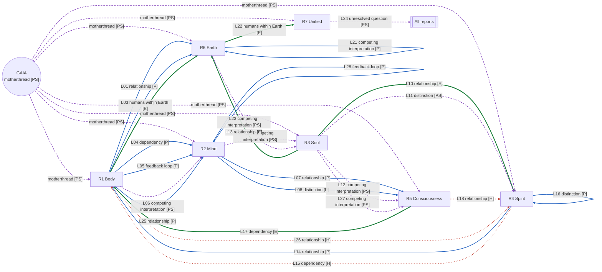

# Link graph (v4; state after Cycle 4)

GAIA (motherthread; **Philosophical/Spiritual**) at the centre with dashed motherthread edges to the seven reports (framework, not findings). The 28 typed links come from `Research/Cycles/Cycle-4-x12/Report-7-Unified/maps/link_register.csv`.

| Edge | From → To | Type | Label |
|---|---|---|---|
| M1 | GAIA → R1 | motherthread | PS |
| M2 | GAIA → R2 | motherthread | PS |
| M3 | GAIA → R3 | motherthread | PS |
| M4 | GAIA → R4 | motherthread | PS |
| M5 | GAIA → R5 | motherthread | PS |
| M6 | GAIA → R6 | motherthread | PS |
| M7 | GAIA → R7 | motherthread | PS |
| L01 | R1 → R6 | relationship | P |
| L02 | R1 → R6 | distinction | P |
| L03 | R1 → R6 | humans within Earth | E |
| L04 | R1 → R2 | dependency | P |
| L05 | R1 → R2 | feedback loop | P |
| L06 | R1 → R2 | competing interpretation | PS |
| L07 | R2 → R5 | relationship | P |
| L08 | R2 → R5 | distinction | P |
| L09 | R2 → R3 | competing interpretation | PS |
| L10 | R3 → R4 | relationship | E |
| L11 | R3 → R4 | distinction | PS |
| L12 | R3 → R5 | competing interpretation | PS |
| L13 | R3 → R6 | relationship | E |
| L14 | R4 → R1 | relationship | P |
| L15 | R4 → R1 | dependency | H |
| L16 | R4 → R4 | distinction | P |
| L17 | R5 → R1 | dependency | E |
| L18 | R5 → R4 | relationship | H |
| L19 | R6 → R6 | dependency | E |
| L20 | R6 → R6 | feedback loop | P |
| L21 | R6 → R6 | competing interpretation | P |
| L22 | R6 → R7 | humans within Earth | E |
| L23 | R6 → R3 | competing interpretation | PS |
| L24 | R7 → ALL | unresolved question | PS |
| L25 | R1 → R2 | relationship | P |
| L26 | R1 → R4 | relationship | H |
| L27 | R3 → R5 | competing interpretation | PS |
| L28 | R2 → R2 | feedback loop | P |

Counts after Cycle 4: 28 links = 6 E / 12 P / 7 PS / 3 H. Change in Cycle 4: L28 (loneliness ↔ depression, P, within Report 2) added; no label changed (strict rule: no downgrade). Report 2 still has no Established link to another report.
